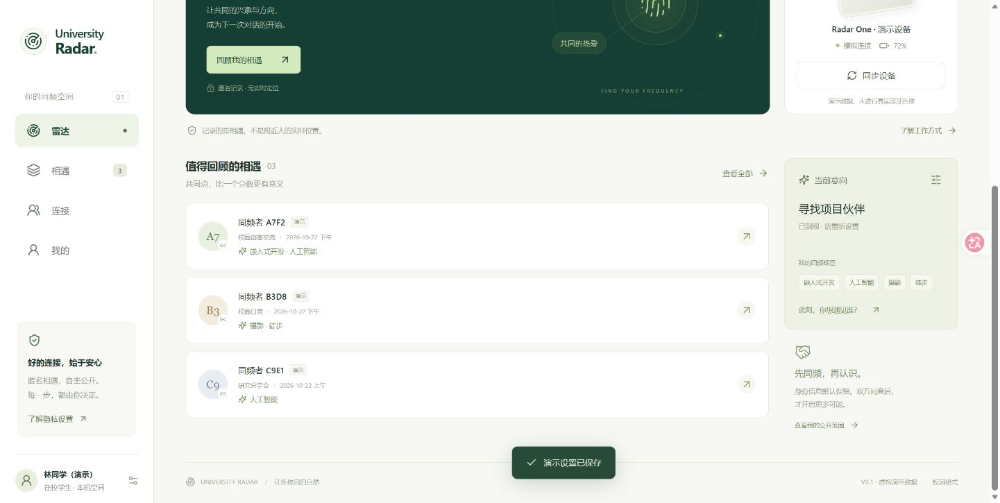

# University Radar

**Development preview — local checks passed; real-device validation is pending.**

University Radar explores offline, consent-based connections in university settings:
shared interests and research directions before graduation, and school, discipline,
research and career connections for alumni. The matching rules are prototype
hypotheses, not validated measures of compatibility.

## Preview scope

- React and TypeScript web app with Radar, Encounters, Network and Profile views.
- Capacitor Android and iOS source projects, with BLE configuration and sync adapters.
- nRF52832-QFAA bare-IC firmware: local two-sided matching, short LED feedback,
  64 Flash encounter records, BLE configuration, pagination and first-phone bonding.
- Shared protocol dictionary in `shared/radar-v1.json`.

The app has a clearly labelled fictional demo. Demo invitations and simulated
acceptance do not send messages to real users or establish real mutual consent.
There is no account service, university identity verification, real messaging or
reporting backend in this preview.



## Run the web app

Use Node.js 24 (or a compatible Node.js version supported by the locked tooling):

```sh
cd software
npm ci
npm run dev
```

Open `http://127.0.0.1:5173`. To validate and build:

```sh
npm test
npm run build
npm run native:sync
npm audit
```

`software/dist` is a static web build. Native BLE uses the Capacitor projects;
browser BLE requires a secure context and a compatible browser.

## Firmware and native platforms

See [firmware build and pin configuration](firmware/README.md),
[BLE protocol](docs/BLE协议_v1.md) and [hardware acceptance checklist](docs/联调与验收.md).
Generate or check shared constants with `python scripts/generate_protocol.py --check`.
After a firmware build, `python scripts/verify_artifacts.py` checks its HEX/BIN image
and native project metadata.

The firmware starts at Flash address 0 and includes the Zephyr Bluetooth stack.
Do not combine it at address 0 with S132 or another bootloader. Confirm the custom
board's power path, exposed-pad ground, RF layout and SWD wiring before powering
or programming it. Vibration is not implemented; this revision uses LEDs.

Android APK compilation requires a JDK and Android SDK. iOS IPA compilation and
signing require macOS and Xcode. Neither installable package has been validated
in this preview; generating/synchronising projects does not establish that they run
on real phones.

## Validation status

Rechecked on **27 October 2026**, for implementation developed in course Week 6:

| Check | Result |
| --- | --- |
| Web business and BLE adapter tests | 18 passed across 3 files |
| TypeScript and production web build | Passed |
| Android/iOS Capacitor resource sync | Passed |
| C11 firmware core assertions with warnings as errors | Passed |
| Full nRF52832 ARM compile/link | Passed; 156,732-byte image |
| HEX checksums, vector table, BIN equality and NVS boundary | Passed |
| Native metadata and patched Xcode parser | Passed |
| npm dependency audit | 0 known vulnerabilities at the check date |
| Desktop and 390 × 844 web layout interactions | Checked; no observed console errors |
| Board flashing, RF, battery, 168-hour runtime, real-phone BLE | Not run |
| Android APK and iOS IPA build/signing | Not run |

Details and limitations: [development record](docs/DEVELOPMENT_LOG.md) and
[validation manifest](docs/VALIDATION_2026-10-27.json).

Broadcast tags/school/stage codes are not encrypted. Just Works bonding has no
MITM authentication. Local app storage is not encrypted. After power loss, the board
requires phone time sync before resuming expiring discovery. One-week battery
life remains an unmeasured target. These limitations are not hidden by passing
unit tests or a successful firmware build.

## Development workflow

See [DEVELOPMENT.md](DEVELOPMENT.md). After an authorised development task,
run relevant checks, update its development record and push the validated changes.
Keep real-device results separate from simulated or host-only checks.
